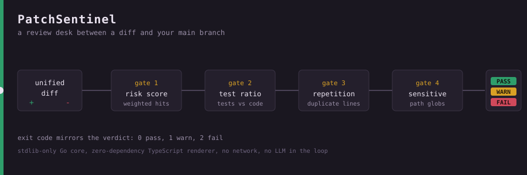

<!-- PatchSentinel — the review desk between a diff and your main branch. -->

<p align="center">
  
</p>

<h1 align="center">PatchSentinel</h1>

<p align="center">
  <em>An editorial review desk for diffs. Every change lines up, walks the gates, and leaves with a stamp — <strong>pass</strong>, <strong>warn</strong>, or <strong>fail</strong> — that CI can trust because it was earned the same way every time.</em>
</p>

<p align="center">
  <code>stdlib-only Go core</code> · <code>zero-dependency TypeScript renderer</code> · <code>no network</code> · <code>no LLM in the loop</code> · <code>byte-identical output</code>
</p>

---

Maintainers don't drown in bad code. They drown in **plausible** code — large, tidy-looking diffs produced in seconds that take a human an hour to actually vouch for. The secret in the base64 blob, the `InsecureSkipVerify: true` three files down, the forty near-identical getters, the 300 new lines with zero tests: they all *look* fine at a glance. PatchSentinel reads the whole diff, measures the boring-but-load-bearing stuff, and puts the risky material in front of your eyes before it reaches your users.

It does **not** claim to detect "AI-written code" — that claim isn't honest and this tool won't fake it. It measures transparent, explainable properties of a unified diff — repetition, risk-pattern hits, test-to-code balance, sensitive-path touches, review cost — and turns them into a reproducible verdict. See [Heuristics, honestly](#heuristics-honestly) for exactly where the lines are.

## Navigation

[60-second tour](#the-60-second-tour) · [Install](#install--build) · [Three diffs, three verdicts](#three-diffs-three-verdicts) · [Anatomy of a score](#anatomy-of-a-score) · [Policy knobs](#policy-knobs) · [Exit codes](#exit-codes) · [Report formats](#report-formats) · [GitHub Actions](#github-actions) · [Triage playbooks](#triage-playbooks) · [Heuristics, honestly](#heuristics-honestly) · [Edge cases](#edge-cases) · [Limitations](#limitations) · [Customization](#customization-recipes) · [Architecture](#architecture) · [Development](#development) · [Roadmap](#roadmap) · [License](#license)

## The 60-second tour

```bash
make build                                   # -> ./bin/patchsentinel
git diff origin/main... | ./bin/patchsentinel -format text
```

The core is a **Go CLI** built from the standard library alone: parse a unified diff (files or stdin), evaluate it against a policy, print evidence, exit with a code that mirrors the verdict. A separate dependency-free **TypeScript renderer** turns that JSON into a self-contained HTML page or GitHub check output. Two languages, one schema, zero runtime dependencies.

<p align="center">
  
</p>

## Install & build

Requires **Go ≥ 1.24** and **Node ≥ 20** (Node only for HTML/GitHub rendering; the CLI stands alone).

```bash
make build      # compile the Go CLI into ./bin/patchsentinel
make test       # run Go + TypeScript test suites
make demo       # regenerate the example HTML + Markdown reports
make help       # list every target

# or raw:
go build -o bin/patchsentinel ./cmd/patchsentinel
cd web && npm install && npm run build      # dev-only deps; runtime stays zero-dep
```

## Three diffs, three verdicts

The `examples/` directory ships three diffs spanning the full spectrum. Output below is the **actual** text from the built CLI — not a mock-up.

### 🟢 `clean.diff` → PASS (exit 0)

A small helper plus its test. Balanced, mergeable.

```text
$ patchsentinel -format text examples/clean.diff
Verdict: PASS
------------------------------------------------------------
Files changed      : 2
Lines +/-          : +23 / -0
Production added   : 11
Test added         : 12
Test-to-code ratio : 1.09
Risk score         : 0
Repetition ratio   : 0.00
Sensitive files    : 0
Est. review time   : 11 min

Findings:
  [INFO] No policy violations detected
    All configured gates passed.

Files:
  modified  +11   -0    pkg/mathutil/mathutil.go
  added     +12   -0    pkg/mathutil/mathutil_test.go  (test)
```

### 🔴 `risky.diff` → FAIL (exit 2)

Hardcoded secrets, `eval`, string-built SQL, wildcard CORS, a TODO, plus edits to an auth service and a CI workflow. Two hard gates trip.

```text
$ patchsentinel -format text examples/risky.diff
Verdict: FAIL
------------------------------------------------------------
Files changed      : 2
Lines +/-          : +27 / -0
Production added   : 27
Test added         : 0
Test-to-code ratio : 0.00
Risk score         : 42
Repetition ratio   : 0.00
Sensitive files    : 2
Est. review time   : 18 min

Findings:
  [ERROR] Risk score exceeds maximum
    Cumulative risk score 42 ≥ max 25.
  [ERROR] Sensitive paths modified
    2 sensitive file(s) changed; require domain-owner review.

Risk signals:
  (w10 x2) hardcoded-secret [services/auth/login.go] Possible hardcoded secret
    var apiKey = "sk_live_51H8xYzABCDEFghijklmnop"
  (w8 x1) eval-usage [services/auth/login.go] Dynamic code evaluation via eval()
    eval("dangerousDynamicCode()")
  (w7 x1) sql-format [services/auth/login.go] Possible SQL built via string concatenation
    return fmt.Sprintf("SELECT * FROM users WHERE name = '" + name + "'")
  (w5 x1) wildcard-cors [services/auth/login.go] Wildcard CORS origin
  (w2 x1) todo-marker [services/auth/login.go] Unfinished work marker
```

Each signal line also prints the offending snippet (two shown above). The risk score **42** = `hardcoded-secret 10×2 + eval 8 + sql-format 7 + wildcard-cors 5 + todo 2`. Nothing hidden.

### 🟡 `generated.diff` → WARN (exit 1)

A brand-new file of 33 added lines: getters/setters plus the *same* `validate()` stub repeated over and over. No dangerous patterns, no tests — just suspicious uniformity.

```text
$ patchsentinel -format text examples/generated.diff
Verdict: WARN
------------------------------------------------------------
Files changed      : 1
Lines +/-          : +33 / -0
Risk score         : 0
Repetition ratio   : 0.75
Sensitive files    : 0
Est. review time   : 12 min

Findings:
  [WARN] High repetition in added code
    Repetition ratio 0.75 ≥ 0.60 suggests boilerplate or generated code that needs closer review.
```

That `0.75` is the fraction of added *meaningful* production lines that are duplicates — the closest thing to a "smells machine-made" signal, phrased as a nudge, not an accusation.

## Anatomy of a score

Five independent signals feed one verdict; the verdict is the worst finding severity.

| # | Signal | What it measures | Default gate |
|---|--------|------------------|--------------|
| 1 | **Risk score** | Σ `weight × matchCount` over risk patterns matching *added* lines | `error` ≥ 25 · `warn` ≥ 10 |
| 2 | **Test-to-code ratio** | `testAdded ÷ productionAdded`, only once `productionAdded ≥ 40` | `warn` < 0.25 |
| 3 | **Repetition ratio** | fraction of added meaningful production lines that are duplicates | `warn` ≥ 0.60 |
| 4 | **Sensitive paths** | changed files matching sensitive globs | `error` if any (→`warn`) |
| 5 | **Review cost** | explainable minutes estimate | `warn` if `ceil` > 90 |

The ten built-in risk patterns, `id (weight)` → what they flag:

- `hardcoded-secret (10)` — `api_key`/`secret`/`password`/`token = "…8+ chars…"`
- `disable-tls (9)` — `InsecureSkipVerify: true`, `rejectUnauthorized: false`, `verify=False`
- `eval-usage (8)` — dynamic code eval via `eval(` · `sql-format (7)` — `SELECT/INSERT/UPDATE/DELETE` built with `+`, `%s`, `${`, `format(`
- `shell-exec (6)` — `exec.Command`, `child_process`, `os.system`, `subprocess.` · `wildcard-cors (5)` — `Access-Control-Allow-Origin: *`
- `unsafe-yaml (4)` — `yaml.Unmarshal`/`yaml.load(` · `broad-except (3)` — bare `except:` / empty `catch () {`
- `todo-marker (2)` — `TODO`/`FIXME`/`XXX`/`HACK` · `debug-print (1)` — `console.log`/`fmt.Println`/`print(`

**Review cost** is deliberately auditable: per file, `added × minutesPerAddedLine + removed × minutesPerRemovedLine + minutesPerFile`, ×`sensitiveMultiplier` for sensitive files, summed. With defaults the risky example is ~17.9 min → rounded to **18 min**. Every report also carries a SHA-256 **content hash** so identical input yields byte-identical, cacheable output.

## Policy knobs

Pass `-policy path.json` and its fields overlay the [built-in default](internal/policy/policy.go). Anything you omit keeps its default; unknown fields are **rejected** so typos fail loudly instead of silently.

```jsonc
{
  "sensitivePaths":   ["**/.github/workflows/**", "**/auth/**", "**/*secret*"],
  "thresholds": {
    "maxRiskScore": 25, "warnRiskScore": 10,
    "minTestRatio": 0.25, "minProductionLinesForTestCheck": 40,
    "maxRepetitionRatio": 0.60, "maxReviewMinutes": 90,
    "sensitivePathIsWarning": false
  },
  "reviewCost": { "minutesPerAddedLine": 0.30, "minutesPerFile": 2.0, "sensitiveMultiplier": 1.5 }
}
```

Also configurable: `testPathPatterns` and the `riskPatterns` array (id/regex/message/weight) — full schema in [docs/POLICY.md](docs/POLICY.md).

Glob tokens: `*` = within a segment, `?` = one non-separator char, `**` = any number of segments. Paths compare with `/`; Windows `\` is normalized.

A shipped `examples/policy.strict.json` tightens thresholds and flips `sensitivePathIsWarning` to `true`. Run it on the generated example and the lower `minProductionLinesForTestCheck` surfaces a *second* finding (review time rises to 16 min):

```text
$ patchsentinel -policy examples/policy.strict.json -format text examples/generated.diff
Verdict: WARN
Findings:
  [WARN] Insufficient test coverage for change size
    Test-to-code ratio 0.00 < required 0.30 for 33 added production lines.
  [WARN] High repetition in added code
    Repetition ratio 0.75 ≥ 0.50 suggests boilerplate or generated code that needs closer review.
```

## Exit codes

The exit code *is* the verdict — no parsing required to gate a pipeline.

| Exit | Verdict | Meaning |
|------|---------|---------|
| `0` | pass | every gate satisfied |
| `1` | warn | acceptable, but notable signals present |
| `2` | fail | at least one hard (`error`) gate violated |
| `2` | — | also used for operational errors (bad flag, unreadable policy, unparsable diff) |

`-strict` promotes a `warn` to exit `2` — warnings block without editing the policy. The TypeScript renderer mirrors the report's `exitCode`, so a second pipeline stage stays consistent.

## Report formats

**Go CLI** `-format`: `json` (default — canonical schema, [web/src/types.ts](web/src/types.ts)) · `text` (stable CI logs) · `markdown` (GitHub summary / PR comment) · `annotations` (`::error`/`::warning` workflow commands).

**TypeScript renderer** `node web/dist/cli.js --format`: `html` (self-contained page) · `github` (the Markdown summary from JSON) · `annotations` (workflow commands with `%`/newline escaping).

Annotations for the risky example:

```text
::error title=Risk score exceeds maximum::Cumulative risk score 42 ≥ max 25.
::error title=Sensitive paths modified::2 sensitive file(s) changed; require domain-owner review.
```
